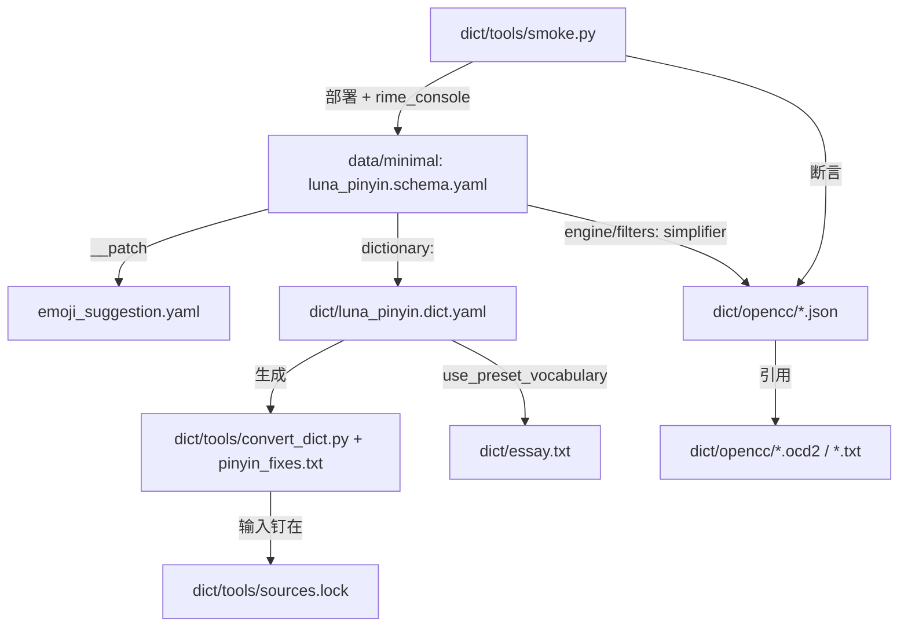

# System architecture

## Overview

三层，边界清楚：

- **引擎源码** `src/rime/**`：librime fork。`src/rime/gear/*` 是组件（translator、
  selector、simplifier…），`src/rime/dict/*` 是词典与 prism 编译，
  `src/rime/lever/*` 是部署（`deployment_tasks.cc` 的 `SchemaUpdate` 决定哪些词典被编译），
  `src/rime/config/*` 是配置层（`__include`/`__patch` 展开在 `config_compiler.cc`）。
- **词库产品** `dict/`：`luna_pinyin.dict.yaml` + `essay.txt` + `opencc/`，全是产物；
  生成链与门在 `dict/tools/`（`convert_dict.py`、`rebuild_ocd2.sh`、`smoke.py`、
  `sources.lock`）。
- **参考部署** `data/minimal/`：schema/default/symbols 与 patch 文件，是词库被消费的
  形态；`smoke.py` 用它 + `dict/` 拼一个真实部署目录。

## Module graph

## Constraints

- **上游对齐**：源码除 `# fork:` 标注的差异外与上游一致，见 [[upstream-alignment]]。
- **复现契约**：`dict/` 只由 `dict/tools/` 生成，手改产物等于放弃 `check` 门，
  订正只进 `pinyin_fixes.txt`，见 [[dict-reproducibility-gates]]。
- **opencc 数据自足**：`opencc_config` 解析成 `<shared_data_dir>/opencc/<file>`；
  缺文件时 filter 照样装好，直到首次转换才记 `opencc config not found` 并原样放行候选
  （`src/rime/gear/opencc.cc:33`）。`CMakeLists.txt` 在 configure 期断言引用闭包。
- **部署只建 `translator/dictionary`**：额外词典要靠 `schema/dependencies` 或独立
  schema；`packs` 与主词库共用 prism，只能补词条、不能加音节、不能单独关。
