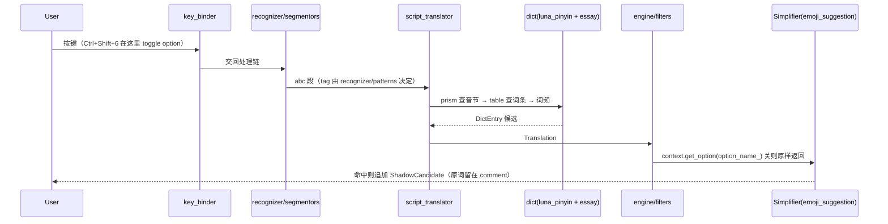

# Key flows

## End-to-end path of a typical request

一次「输入到上屏」在真实引擎里的路径（`rime_console` 就是这条链的最小载体，也是
smoke 门的驱动器）：

## Other important flows

- **数据生成**：`sources.lock` 钉输入 → `convert_dict.py`（读 git 历史里的繁体底本 +
  套 `pinyin_fixes.txt`）→ `essay.txt`/`luna_pinyin.dict.yaml`；`rebuild_ocd2.sh` 生成
  `.ocd2` 并原样拷贝 vendored 文件（含 emoji 三件）。
- **两道门**：`make -C dict/tools check` 逐字节比对；`make -C dict/tools smoke` 建临时
  部署（含 `<root>/opencc/`）跑 `rime_console`，断言零 glog error + 提交文本 + 简拼首页
  + emoji 开关两侧。
- **上游同步**：`git fetch upstream && git merge upstream/master`，`dict/` 与
  `data/minimal/` 上游无同名文件，冲突只可能来自 `src/`；合并后必跑四平台 CI。
