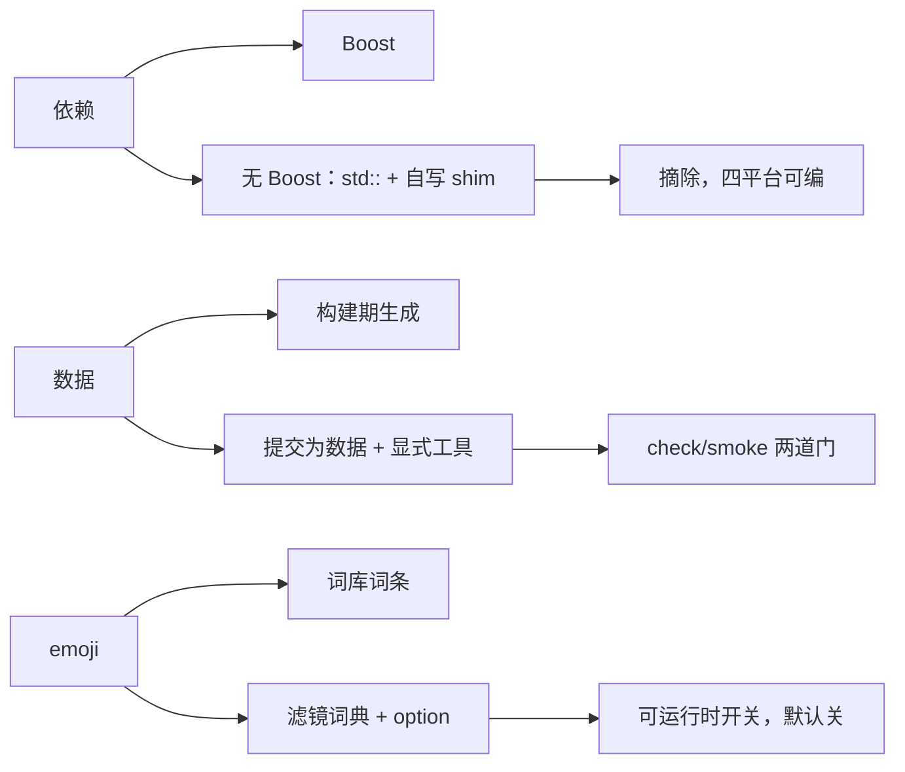

# Tech stack

## Technology choices

| domain | candidates | decision | rationale |
|---|---|---|---|
| 正则 | Boost.Regex / PCRE / std::regex | `std::regex`（ECMAScript）+ `src/rime/pcre_translator.hpp` 翻译层 | 去 Boost；PCRE 语法要翻译成 ECMAScript，翻译不过的模式必须显式报错而不是静默丢弃 |
| 算法/信号/UUID/CRC/动态库 shim | Boost.* / 自写 | `src/rime/{string_utils,signal,uuid,crc32,scope_exit,shared_library}.hpp` 里 boost 命名空间的自写替身 | 保持调用点形状，减少与上游的冲突面；替身必须逐条对齐原库语义（见 [[upstream-alignment]]） |
| 简繁/字形转换 | OpenCC 外部依赖 / vendored | vendored 在 `deps/opencc`（1.1.9，源码提交进仓） | 构建不依赖系统 opencc；`OPENCC_BUILD_DATA`/`OPENCC_TOOLS` 本地关掉其数据步骤 |
| 词库数据形态 | 引擎生成 / 提交为数据 | 全部提交为数据，工具在 `dict/tools/` 显式 `make` | 见 background 的 Non-goals；`check` 门保证可复现 |
| emoji 扩展 | 独立 `.dict.yaml` + 前缀 / `translator/packs` / opencc 滤镜 | opencc text 词典 + option 门控的 `simplifier` | 只有 option 门控的组件能运行时整体开关，见 [[emoji-filter-dictionary]] |
| 测试 | gtest（`build/test/rime_test`）+ 引擎级 smoke | 两者都要 | 单测覆盖组件，smoke 覆盖「真部署用得动」 |
| 代码风格 | clang-format（CI 固定 23，`make clang-format-lint`） | 版本敏感：本地 18 与 CI 23 结论不同 | 比对违规计数要在同一 formatter 下跑 HEAD 与工作区 |

## Decision mindmap

## Open items

- 本地只有 clang-format 18，CI 用 23：`action-install-clang-format.sh` 走 `sudo apt`，
  未擅自安装。改动 C++ 时需按「同 formatter 下 HEAD 与工作区违规计数相同」自证。
- 「本仓不含系统 Boost」要靠构建产物自证（`.o.d` 零 boost 命中），开发机装了 Boost，
  本地绿不等于 CI 绿。
- `essay.txt` 不裁剪（43.7 万条全留），是否值得做分级加载未定。
